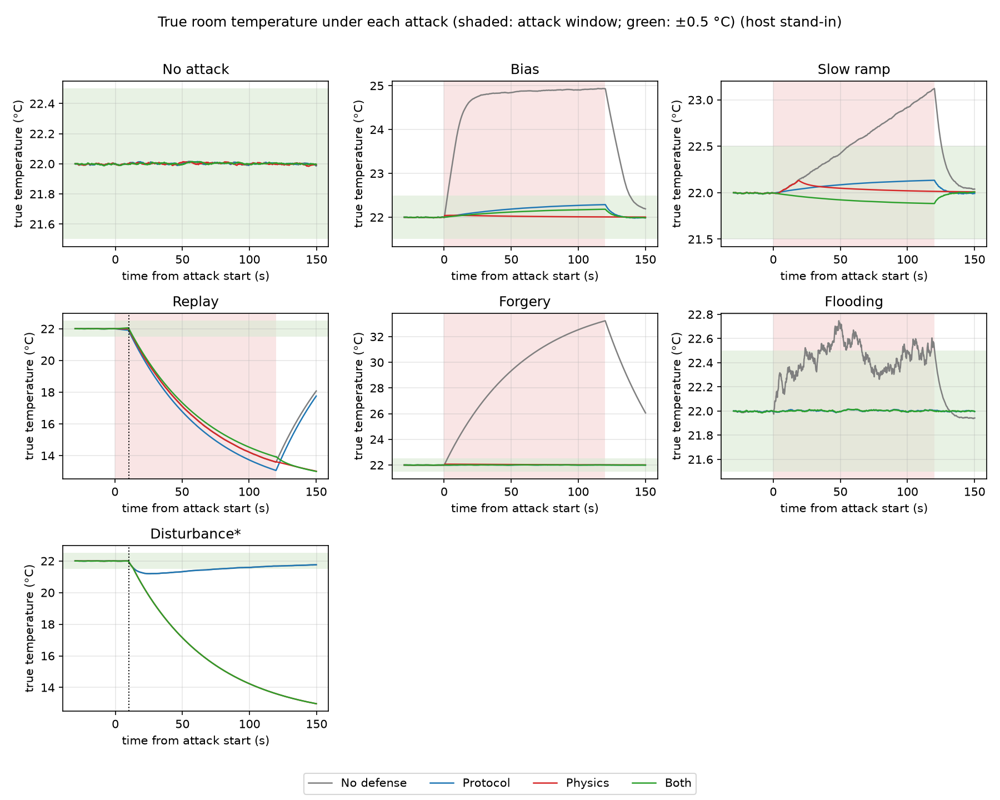
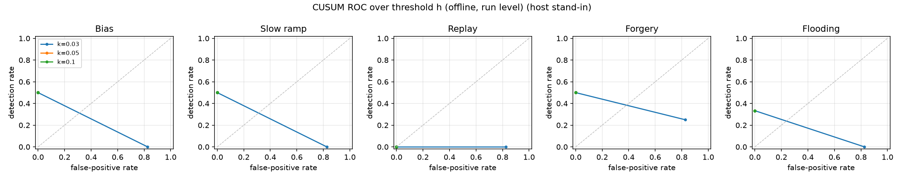

# LoopShield

Layered sensor spoofing detection for a networked temperature controller, built
with C, C#, MQTT, ESP-IDF/FreeRTOS, and Python.

LoopShield combines message authentication and replay checks with a model-based
physics detector. An automated harness injects attacks, switches defenses, and
compares controller telemetry with the room model's independent ground truth.
The Windows workflow runs the firmware's portable C defense code in a local
host controller; no Wokwi or physical ESP32 is required.

**Status:** working host-based evaluation prototype with preliminary results.
ESP32 firmware is included, but the results below do not validate hardware
execution times or real-time deadlines.

## Architecture

```text
Room/heater model <--> MQTT broker :1884 <--> Attack proxy :1883 <--> Controller
                           ^                                      (C defense code)
                           |
                    Evaluation harness
                  configuration + logging
                           |
                     Python analysis
```

The proxy stays in the path even for attack-free runs. The plant signs sensor
readings and records true temperature separately from the readings seen by the
controller. The harness starts the proxy and plant for each run and waits for
the controller to acknowledge the requested defense configuration.

## Implemented defenses

- **Protocol:** HMAC-SHA256 truncated to 64 bits, increasing sequence numbers,
  and timestamp freshness checks. Freshness uses a minimum observed clock
  offset with a 250 ms window and 1% drift allowance.
- **Physics:** model-based observer, two-sided CUSUM, and bounds on the rate of
  temperature change. On an alarm, mitigation regulates the model estimate.
- **Stale readings:** after five periods without fresh data, hold the actuator
  output instead of integrating stale measurements.

The nominal control period is 100 ms. Sensor and actuator messages use a fixed
28-byte little-endian format, including an 8-byte MAC. Defense options are
changed at runtime through `sg/config`.

## Quick start on Windows

Run commands from the repository root in PowerShell. Prerequisites:

- .NET 10 SDK (`dotnet --version`)
- 64-bit MinGW GCC on PATH (`gcc --version`)
- Python with the `py` launcher, for analysis
- Local TCP ports 1883 and 1884 available

Run a short bias attack with both defenses enabled:

```powershell
.\scripts\run-local.ps1
```

The launcher builds the .NET projects and native Windows library, starts the
broker and host controller, runs the evaluation, and stops those services when
it finishes. Service logs go to `runs/local-services-<timestamp>/`.
The room/heater remains a software model.

Run all seven scenarios across four defense configurations, once per cell:

```powershell
.\scripts\run-local.ps1 matrix --trials 1
```

This takes approximately 1.5 hours. Results go to `runs/matrix-<timestamp>/`.
For an explicit output folder, or to resume an interrupted session:

```powershell
.\scripts\run-local.ps1 matrix --trials 1 --out runs/my-session
```

The harness skips runs already marked complete. It does not automatically
replace completed runs that the analyzer later flags as invalid.

Run a specific cell:

```powershell
.\scripts\run-local.ps1 single --attack replay --config both --out runs/replay-check
```

Configurations: `none`, `proto`, `phys`, `both`. Common options include
`--warmup 30 --attack-s 120 --recover 30`, `--no-mitigate`, `--k 0.05`, and
`--h 4`. The default quick check uses shorter windows and is only a smoke test.

## Analyze a session

Install dependencies once, then substitute your session folder:

```powershell
py -m pip install -r eval/requirements.txt
py eval/analyze.py runs/my-session --out results/my-session
```

Outputs include:

| File | Purpose |
| --- | --- |
| `matrix.md` / `matrix.csv` | Detection, time to detect, temperature deviation, false positives |
| `runs.csv` | Per-run metrics and validity flags, including excluded runs |
| `temp_grid.png` / `temp_<attack>.png` | True temperature and controller behavior |
| `roc.csv` / `roc.png` | Offline CUSUM threshold sweep |
| `timing.csv` / `timing.png` | Diagnostic timing; host measurements are not ESP32 results |
| `*.tex` | Generated tables for the paper draft |

The analyzer excludes runs flagged as reset or insufficiently covered. A blank
matrix cell means no valid result was aggregated for that cell.

## Preliminary results

The checked-in [analysis snapshot](results/local-matrix/README.md) comes from
`matrix-20261110-231635`: one trial per cell, 30 s warmup, 120 s attack, and
30 s recovery. Of 28 cells, 27 were included by the analyzer. These are
observations from a single host-based session, not statistical reliability
estimates. A displayed 100% detection rate represents one detected trial.

| Attack | No-defense maximum deviation | Both defenses: detection time | Both defenses: maximum deviation |
| --- | --- | --- | --- |
| Bias | 2.94 C | 0.066 s | 0.18 C |
| Slow ramp | 1.12 C | 0.155 s | 0.12 C |
| Forgery | 11.24 C | 0.083 s | 0.02 C |
| Replay | 8.41 C | 0.145 s | 9.00 C |
| Flooding | 0.75 C | 0.028 s | 0.01 C |

Bias, ramp, and forgery were detected within 0.2 seconds with both defenses,
with true-temperature deviation below 0.19 C in those trials.



*True room temperature from the plant's ground-truth log. Red shading marks
the attack window; green marks the ±0.5 C band around the 22 C setpoint. The
replay and disturbance panels show the uncorrected ambient drop described
below.*



*Offline CUSUM threshold sweep over the same logged session; it is not an
independent validation experiment. The timing plot (`timing.png`) is omitted
here because of the counter anomaly noted below.*

**Known limitations in this session:**

- Replay was detected by protocol checks, but the controller still deviated
  about 9 C during the replay scenario's real ambient drop. Detection did not
  ensure successful mitigation. Physics alone did not detect replay.
- A legitimate ambient drop triggered physics alarms in both physics-enabled
  configurations. Their deviation was about 9.03 C, versus about 0.8 C with
  physics disabled. Disturbance handling and model-based mitigation need work.
- The physics-only flooding cell was excluded because the analyzer flagged a
  controller reset. The cause has not been established.
- Later response-time values jump to roughly 4.29 billion microseconds, with
  anomalous deadline counts. These indicate a suspected timing/counter defect
  that needs investigation. Do not use this snapshot for deadline claims.
- Multiple trials and hardware measurements remain future validation work.
  This session does not establish that combining defenses always outperforms
  protocol checks alone.

See the [full generated matrix](results/local-matrix/matrix.md) and
[per-run metrics](results/local-matrix/runs.csv) for the complete observations.

## Attack scenarios

| Scenario | Default behavior |
| --- | --- |
| `none` | Transparent proxy, no attack |
| `bias` | Subtract 3 C from each reading without a valid replacement MAC |
| `ramp` | Grow the reading offset at -0.01 C/s |
| `replay` | Loop 30 s of genuine readings; also lower real ambient to 5 C |
| `forgery` | Inject fake 18 C readings with a random MAC |
| `flood` | Inject random sensor messages at a configured 1000 messages/s |
| `disturb` | Lower real ambient to 5 C without an attack; test false positives |

The flooding rate is a requested injection rate, not guaranteed measured
throughput. Four defense configurations make 28 cells per trial.

## Repository layout

| Directory | Contents |
| --- | --- |
| `firmware/main/` | ESP-IDF controller and portable C protocol/detector/PI modules |
| `firmware/test/` | Protocol tests, state-machine search, standalone simulation, C ABI |
| `firmware/test/hostctl/` | MQTT host controller using the portable firmware code |
| `broker/` | Local MQTT broker |
| `plant/` | Room/heater model and independent ground-truth logging |
| `attacker/` | MQTT attack proxy |
| `harness/` | Attack/defense orchestration and data collection |
| `shared/` | C# message format, authentication, topics, and ports |
| `eval/` | Python analysis |
| `scripts/` | Windows local-run launcher |
| `results/local-matrix/` | Preliminary generated analysis and session metadata |
| `paper/` | LaTeX research write-up draft |

Raw run folders and build products are ignored by Git. The committed analysis
snapshot allows inspection of reported metrics; reproducing plots from raw
telemetry requires retaining the original session locally or making a new run.

## Other development workflows

On Linux with .NET 10, GCC, and Make:

```bash
dotnet build
make -C firmware/test test
make -C firmware/test search
make -C firmware/test hostlib
dotnet build firmware/test/hostctl
```

Start the broker and host controller in separate terminals, then run the harness:

```bash
# Terminal 1
./broker/bin/Debug/net10.0/LoopShield.Broker
# Terminal 2
./firmware/test/hostctl/bin/Debug/net10.0/LoopShield.HostCtl
# Terminal 3
./harness/bin/Debug/net10.0/LoopShield.Eval matrix --trials 1
```

The optional standalone C simulation is `make -C firmware/test sim`; the Windows
MQTT workflow above does not use it. To build the ESP32 firmware, activate an
ESP-IDF v6.1 environment and run `idf.py -C firmware build`. Hardware execution
and deadline validation are separate from the host-based results reported here.

This is an experimental local testbed. Its authentication and mitigation design
has not been validated for deployment in a production control system.

## License

Released under the [MIT License](LICENSE).
